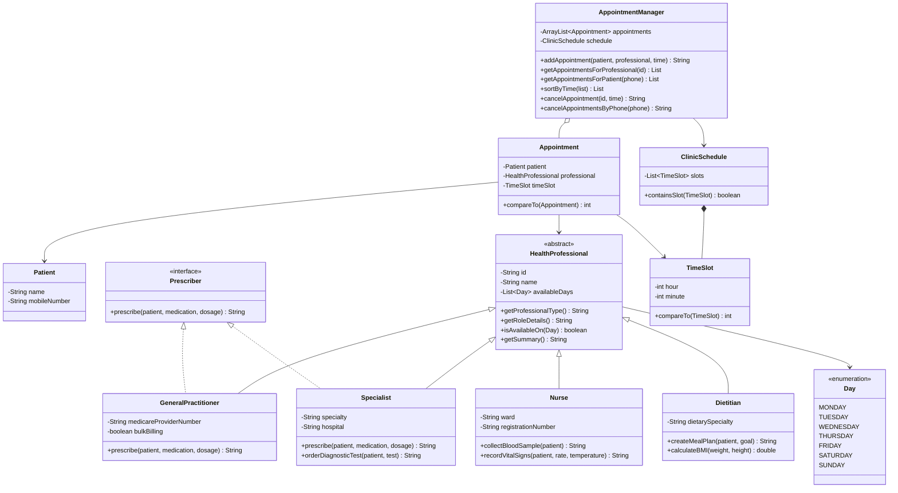

# PROG2004 Assessment 1 - Health Service Appointment System

**Unit:** PROG2004 Object Oriented Programming
**Assessment:** Assessment 1 - Portfolio/programming (40%)
**Student:** Shi Jiaen (25259230)
**Project:** `A1-25259230`

A Java implementation of the object-oriented backbone of a health service
appointment system. The program has no menu, login, database or user
interface, as required by the brief: `AssignmentOne.main` creates the objects,
exercises their behaviour and prints a scripted simulation to the console.

---

## 1. How to run

### IntelliJ IDEA

1. Open the `A1-25259230` folder as a project.
2. Mark `src` as the source root (right-click `src` > Mark Directory as >
   Sources Root).
3. Open `src/AssignmentOne.java` and run `main`.

### Command line (JDK 11 or later)

From the `A1-25259230` folder:

```bash
javac -d out src/*.java
java -cp out AssignmentOne
```

No external libraries are used. Only concepts from Modules 1-3 are applied:
classes and objects, encapsulation, overloading, inheritance, abstract
classes, interfaces, polymorphism, enums, `ArrayList`, `Comparable` /
`Collections.sort`, `equals` / `hashCode`, `toString`, exceptions and Javadoc.

---

## 2. Project structure

```
A1-25259230/
├── src/
│   ├── AssignmentOne.java          # main method and scripted demonstration
│   ├── HealthProfessional.java     # abstract base class (Part 1)
│   ├── GeneralPractitioner.java    # Part 2: GP, implements Prescriber
│   ├── Specialist.java             # Part 2: specialist, implements Prescriber
│   ├── Nurse.java                  # Part 2: nurse
│   ├── Dietitian.java              # Part 2: dietitian
│   ├── Prescriber.java             # interface for prescribing behaviour
│   ├── Day.java                    # enum of working days
│   ├── Patient.java                # patient name and mobile number
│   ├── TimeSlot.java               # time of day, Comparable
│   ├── ClinicSchedule.java         # configurable daily slot schedule
│   ├── Appointment.java            # patient + professional + time
│   ├── AppointmentManager.java     # collection management (Part 5)
│   ├── ClinicRoster.java           # collection of all professionals
│   └── Validation.java             # shared validation helpers
├── docs/
│   ├── video-plan.md               # plan for the four-pillars video
│   └── submission-checklist.md     # before-you-submit checklist
└── README.md
```

---

## 3. Class design



Text version of the hierarchy:

```
HealthProfessional (abstract)
├── GeneralPractitioner   implements Prescriber
├── Specialist            implements Prescriber
├── Nurse
└── Dietitian
```

---

## 4. How each part of the brief is addressed

### Part 1 - Modelling a health professional

`HealthProfessional` is an **abstract class** holding the data common to every
professional:

| Field | Type | Why |
|---|---|---|
| `id` | `String` | Must contain digits only; stored as text because it is an identifier, not a number to calculate with. |
| `name` | `String` | Common to every professional. |
| `availableDays` | `List<Day>` | A fixed collection of values; `Day` is an enum so an invalid day cannot be stored. |

Design choices:

- **Controlled access / no invalid state.** Fields are `private final`. The
  constructor validates the ID, name and roster through `Validation`. There are
  no setters, so an object cannot be changed into an invalid state after it is
  created. `getAvailableDays()` returns a **copy**, so external code cannot
  modify the internal list.
- **Readable printing.** `HealthProfessional.toString()` prints the type, ID,
  name, roster and role details. It calls the abstract `getRoleDetails()`, so
  subclasses extend the output without rewriting the common part.
- **More than one constructor.** The two-argument constructor defaults to
  Monday-to-Friday (`Day.weekdays()`). This is used for several professionals
  in the demonstration.
- **Identity.** `equals()` and `hashCode()` are based on `id`, because the
  clinic's IDs are unique. This is what lets the manager recognise a
  double booking even when it is given a different object with the same ID.
- **No generic professional.** The class is abstract and declares two abstract
  methods (`getProfessionalType()` and `getRoleDetails()`), so a plain
  `HealthProfessional` cannot be created and every subtype must provide the
  required behaviour.

### Part 2 - Specialising health professionals

Four distinct types extend the base class:

1. **`GeneralPractitioner`** - Medicare provider number and bulk-billing flag;
   can prescribe.
2. **`Specialist`** - specialty and base hospital; can prescribe and order
   diagnostic tests.
3. **`Nurse`** - ward and registration number; can collect a blood sample and
   record vital signs.
4. **`Dietitian`** - dietary specialty; can create a meal plan and calculate /
   classify BMI.

Each subclass:

- calls `super(...)` so the shared fields are validated and stored once;
- adds only its own fields and behaviour;
- overrides `getProfessionalType()` so `System.out.println` clearly identifies
  what kind of professional it is;
- overrides `getRoleDetails()` so its own information appears in the inherited
  `toString()`;
- offers an overloaded constructor that uses the default Monday-to-Friday
  roster.

`Prescriber` is a separate interface implemented by the GP and the specialist.
Prescribing is not common to all professionals, so it does not belong in the
base class: nurses and dietitians must not inherit behaviour they do not have.

### Part 3 - Working with health professional objects

`AssignmentOne.demonstratePartThree()` creates three GPs and two of each other
type. All nine objects are stored in one `ArrayList<HealthProfessional>` and
printed in a single loop. The loop only knows the common supertype, yet each
object prints its own type and details. Adding a fifth professional type would
not require this loop to change.

The same section also shows:

- availability lookup through the common type;
- a `List<Prescriber>` loop that calls `prescribe()` on every doctor;
- subtype-specific behaviour (`collectBloodSample`, `createMealPlan`,
  `orderDiagnosticTest`) after an `instanceof` check.

### Part 4 - Modelling an appointment

`Appointment` holds:

- a `Patient` object (name + mobile number),
- a `HealthProfessional` reference, and
- a `TimeSlot`.

`Patient` is its own class because the name and contact number belong together
and can be reused by every appointment. The professional field uses the
**general type**, so one `Appointment` class works with a GP, specialist, nurse
or dietitian.

- **No incomplete appointments.** The constructor rejects `null` for all three
  required parts; `Patient` validates the name and 10-digit mobile number.
- **Readable printing.** `Appointment.toString()` shows the time, patient and
  the professional's type, name, ID and role details.
- **Ordering.** `Appointment implements Comparable<Appointment>` and compares
  only the time. `TimeSlot` stores hour and minute and also keeps the time as
  `minutesFromMidnight`, so comparison is a simple integer comparison and
  `Collections.sort` orders appointments correctly from earliest to latest.
  Same-time appointments for different professionals compare as equal; because
  `Collections.sort` is stable, they keep the order in which they were added,
  which the brief allows.

### Part 5 - Managing the collection of appointments

`AppointmentManager` stores appointments in an **`ArrayList<Appointment>`**.
The choice is deliberate:

- appointments must be added and removed during the day;
- two appointments at the same time for different professionals are both valid;
- a sorted set would treat those same-time appointments as duplicates because
  `compareTo` compares time only, and one would be lost.

Operations:

| Requirement | Method |
|---|---|
| Add, with all required information and no double booking | `addAppointment(...)` |
| View all | `getAllAppointments()` + `formatAppointments(...)` |
| Filter by professional ID | `getAppointmentsForProfessional(...)` |
| Filter by patient phone | `getAppointmentsForPatient(...)` |
| Sort all or a filtered subset by time | `sortByTime(list)` |
| Cancel by professional ID + time | `cancelAppointment(id, TimeSlot)` |
| Cancel by phone | `cancelAppointmentsByPhone(...)` |
| Warning when an action cannot be performed | every method returns `SUCCESS:` or `WARNING:` messages |

Double booking is detected with
`appointment.isBookedFor(professional, timeSlot)`, which uses
`HealthProfessional.equals()` (ID-based) and `TimeSlot.equals()`.

The schedule is **not hard-coded**. `ClinicSchedule` is built from an opening
time, a closing time and a slot length, and generates the slots in a loop. The
demonstration creates a second `ClinicSchedule("Saturday Clinic", 9, 0, 12, 0, 45)`
and books appointments against it without changing any booking code.

### Part 6 - Working with appointments

`AssignmentOne.demonstratePartSix()` runs a fresh clinic day end-to-end:

1. book five appointments across GP, nurse, specialist and dietitian;
2. display the whole day sorted by time;
3. filter by professional ID;
4. filter by patient phone;
5. sort the filtered subset;
6. cancel one appointment by professional ID and time;
7. display the remaining appointments to show the collection changed;
8. attempt a double booking and a cancellation that does not exist, showing
   the warning messages.

Part 5 also covers the remaining error cases: booking outside the schedule,
booking without a patient, cancelling with an unknown phone number and
cancelling with invalid time text.

---

## 5. The four pillars of OOP in this solution

| Pillar | Where it appears | Why it was used |
|---|---|---|
| **Encapsulation** | `HealthProfessional` private final fields, validation in constructors, copy returned by `getAvailableDays()`; `Patient` validation; `Appointment` null checks; `AppointmentManager` private `appointments` list | To protect each object's state and make invalid objects impossible to create. |
| **Abstraction** | Abstract `HealthProfessional` with abstract `getProfessionalType()` / `getRoleDetails()`; `Prescriber` interface; `ClinicSchedule` hiding slot generation | To model only what is common, hide implementation detail, and force every subtype to supply the behaviour it must have. |
| **Inheritance** | `GeneralPractitioner`, `Specialist`, `Nurse`, `Dietitian` extend `HealthProfessional`; `super(...)`; overloaded constructors | To reuse the shared ID, name, roster, validation, `toString`, `equals` and `hashCode` instead of duplicating them in four classes. |
| **Polymorphism** | `List<HealthProfessional>` loop in Part 3; overridden `getProfessionalType()` / `getRoleDetails()` / `toString()`; `List<Prescriber>` loop calling `prescribe()`; `Comparable` / `Collections.sort` | So mixed objects can be stored and processed together while each responds in its own way; sorting works through a common comparison contract. |

---

## 6. Design decisions and trade-offs

- **`ArrayList` rather than `HashMap` or `TreeSet` for appointments.** The day
  is small, must keep same-time appointments for different professionals, and
  is displayed in time order. An `ArrayList` plus `Collections.sort` is the
  simplest structure that meets all three needs. A `TreeSet` would drop
  same-time entries because they compare as equal on time.
- **ID is a `String`, not an `int`.** IDs are identifiers, not quantities.
  `Validation.isDigitsOnly` enforces the "numbers only" rule, and leading zeros
  could be stored safely.
- **`TimeSlot` stores hour/minute plus `minutesFromMidnight`.** The fields make
  validation and formatting clear; the single minute value makes ordering
  correct and cheap. Using `String` times would sort "10:00" before "9:00".
- **`equals`/`hashCode` on the professional's ID.** This is the Java way to
  answer "are these two appointments for the same health professional?" and it
  is used directly by the double-booking check.
- **Messages returned, not printed, by the manager.** This keeps the model
  independent of the console and lets `main` decide how results are displayed.
- **Current-day bookings only.** As the brief limits bookings to the current
  day, the weekly roster is displayed but is not used to reject a booking. The
  rule that Part 5 requires is the double-booking rule, which is enforced.
- **No untaught features.** No streams, lambdas, records, `Optional`, database
  or UI code. Collections, enums, interfaces, abstract classes and
  `Comparable` are the most advanced constructs used.

---

## 7. Demonstration output

The program prints a numbered walkthrough of Parts 3-6. A short extract:

```
============================================================
PART 3 - WORKING WITH HEALTH PROFESSIONAL OBJECTS
============================================================
[1]
General Practitioner | ID: 1001
  Name: Dr Alice Nguyen
  Available days: Monday, Wednesday, Friday
  Medicare provider number: MED-55821 | Bulk billing: yes
...

------------------------------------------------------------
All appointments sorted by time
------------------------------------------------------------
All appointments sorted by time (8)
  1. 08:30 | Tom Baker (0433 210 987) | Specialist (Cardiologist) Dr Sofia Marchetti (ID 2001)
  2. 09:00 | Jane Smith (0412 345 678) | General Practitioner Dr Alice Nguyen (ID 1001)
  ...
```

---

## 8. Submission notes

- The project folder is already named `A1-25259230` and the Javadoc
  `@author` tags are filled in. If your MySCU username is not the student
  number, rename the folder and the zip to `A1-<MySCU username>`.
- The GitHub repository should contain this project and a history of
  meaningful commits made while the work was developed.
- Add the WakaTime report as `A1-25259230-WakaTime.png` (or `.jpg` / `.pdf`).
- Record the five-minute video using `docs/video-plan.md` as a guide, upload it
  to SCU OneDrive and put the shareable link in the submission comments.
- Complete the GenAI declaration honestly in the submission comments and make
  sure you can explain every line of the code. The unit warns that an interview
  may be required if the code cannot be explained.

See `docs/submission-checklist.md` for the full list.
